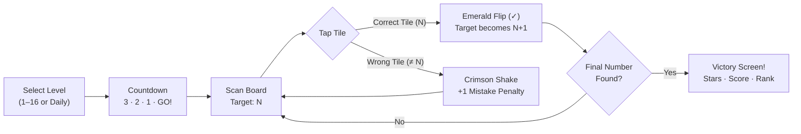
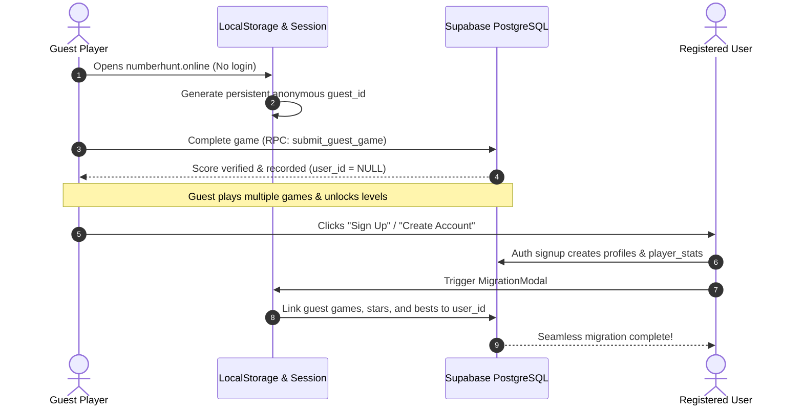
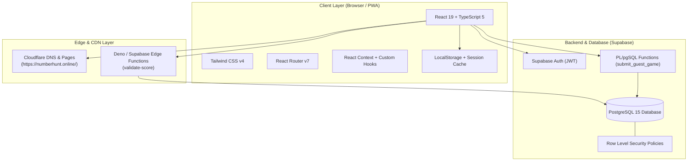

<div align="center">

# 🎯 Number Hunt

### *Find the numbers. Beat the clock. Ascend the global leaderboard.*

**A competitive, fast-paced number memory and reaction web game built with React 19, TypeScript, Tailwind CSS v4, and Supabase.**

<br />

[](https://numberhunt.online/)
[](https://numberhunt.online/)
[](#-testing-suite)
[](LICENSE)

<br />

[](https://react.dev/)
[](https://www.typescriptlang.org/)
[](https://vitejs.dev/)
[](https://tailwindcss.com/)
[](https://supabase.com/)
[](https://www.postgresql.org/)
[](https://deno.land/)
[](https://numberhunt.online/)

---

### 🌐 [https://numberhunt.online/](https://numberhunt.online/)
*Play instantly in your browser — mobile, tablet, or desktop. No sign-up required!*

<br />

<a href="https://numberhunt.online/">
  
</a>

</div>

<br />

## 📖 Table of Contents

- [🌟 Features & Highlights](#-features--highlights)
- [🕹️ How It Works (Gameplay Loop)](#️-how-it-works-gameplay-loop)
- [📐 16 Levels & Grid Matrix](#-16-levels--grid-matrix)
- [🧮 Scoring System & Mathematical Formulas](#-scoring-system--mathematical-formulas)
- [⭐ 3-Star Rating Algorithm](#-3-star-rating-algorithm)
- [📅 Deterministic Daily Challenge](#-deterministic-daily-challenge)
- [🏆 Achievements & Progression](#-achievements--progression)
- [👤 Dual-Player Pipeline (Guest & Cloud Migration)](#-dual-player-pipeline-guest--cloud-migration)
- [🛡️ Anti-Cheat, Security & RLS Architecture](#️-anti-cheat-security--rls-architecture)
- [📊 Admin Analytics & Moderation Suite](#-admin-analytics--moderation-suite)
- [🛠️ Tech Stack & System Architecture](#️-tech-stack--system-architecture)
- [📂 Project Directory Structure](#-project-directory-structure)
- [🚀 Local Development & Quickstart](#-local-development--quickstart)
- [🗄️ Supabase Backend Provisioning](#️-supabase-backend-provisioning)
- [🧪 Testing Suite](#-testing-suite)
- [🌐 Deployment](#-deployment)
- [📄 License & Credits](#-license--credits)

---

## 🌟 Features & Highlights

- **⚡ Buttery Smooth 60 FPS Micro-Interactions**: Built using React 19 and Tailwind CSS v4 with custom GPU-accelerated CSS animations (`card-flip`, `card-wrong`, `shake`, `scale-in`).
- **🎮 16 Handcrafted Progressive Levels**: Difficulty scales smoothly from 5 numbers on a compact $2 \times 3$ grid up to 20 numbers packed into an intense $4 \times 5$ layout.
- **📅 Deterministic Daily Challenge**: All players across the world receive the exact same daily board seed to compete for global daily leaderboard dominance.
- **👤 Instant Guest Play + Automatic Cloud Migration**: Play instantly without logging in! Your progress, high scores, stars, and streaks are tracked locally. If you choose to sign up later, a 1-click cloud migration modal transfers everything to your new Supabase profile.
- **🛡️ Enterprise-Grade Anti-Cheat Defenses**:
  - Cryptographic single-use client replay tokens.
  - Sub-millisecond human reaction plausibility filters per level.
  - Rate limiting (max 60 submissions / hour).
  - Serverless Deno Edge Function (`validate-score`) canonical score recalculation.
- **📊 Real-time Executive Admin Dashboard**:
  - Live analytics for registered players and anonymous guests.
  - Interactive SVG visualizations: Volume trends, active player timelines, and level drop-off curves.
  - Anti-cheat audit feed with one-click verification and user banning controls.
- **📱 Fully Responsive & PWA-Ready**: Optimized for touchscreens, mobile safari, tablets, laptops, and ultra-wide desktop monitors.
- **🎨 Neo-Brutalist Tech Theme**: Dark obsidian background (`#0b0f19`), warm electric amber (`#f97316`), emerald green (`#22c55e`), and crimson red (`#ef4444`) with high-contrast `JetBrains Mono` and `Inter` typography.

---

## 🕹️ How It Works (Gameplay Loop)



1. **The Countdown**: When entering a level, a clean glassmorphism modal counts down `3... 2... 1... GO!`, locking the timer until the tiles are revealed.
2. **The Target Display**: The top center header displays the current target number (e.g. `TARGET: 1`) in bold electric amber.
3. **Ascending Order Hunting**: Scan the face-down tiles (represented with subtle indicator dots) and tap the number that matches the current target.
4. **Tile Responses**:
   - **Correct Tap**: The tile flips in 3D to reveal the number with an emerald green checkmark (`✓`). The target immediately advances to the next ascending integer ($N + 1$).
   - **Wrong Tap**: The tile flashes crimson red with a horizontal shake animation displaying `"Wrong"`, and adds $+1$ to your mistake counter.
5. **Level Completion**: Tapping the final number immediately halts the precision millisecond timer and computes your score, accuracy, stars, and personal record.

---

## 📐 16 Levels & Grid Matrix

Number Hunt features 16 levels split across 5 difficulty tiers. As you advance, both the number count and grid density increase:

| Level | Number Count | Grid Dimensions | Difficulty Bracket | Multiplier | Min Plausible Time |
| :---: | :---: | :---: | :---: | :---: | :---: |
| **1** | 5 Numbers | $2 \times 3$ (6 cells) | 🟢 **Easy** | $1.0\times$ | $1,200\text{ ms}$ |
| **2** | 6 Numbers | $2 \times 3$ (6 cells) | 🟢 **Easy** | $1.0\times$ | $1,500\text{ ms}$ |
| **3** | 7 Numbers | $2 \times 4$ (8 cells) | 🟢 **Easy** | $1.0\times$ | $1,800\text{ ms}$ |
| **4** | 8 Numbers | $2 \times 4$ (8 cells) | 🔵 **Normal** | $1.2\times$ | $2,200\text{ ms}$ |
| **5** | 9 Numbers | $3 \times 3$ (9 cells) | 🔵 **Normal** | $1.2\times$ | $2,600\text{ ms}$ |
| **6** | 10 Numbers | $3 \times 4$ (12 cells) | 🔵 **Normal** | $1.2\times$ | $3,000\text{ ms}$ |
| **7** | 11 Numbers | $3 \times 4$ (12 cells) | 🔵 **Normal** | $1.2\times$ | $3,500\text{ ms}$ |
| **8** | 12 Numbers | $3 \times 4$ (12 cells) | 🟡 **Hard** | $1.5\times$ | $4,000\text{ ms}$ |
| **9** | 13 Numbers | $4 \times 4$ (16 cells) | 🟡 **Hard** | $1.5\times$ | $4,600\text{ ms}$ |
| **10** | 14 Numbers | $4 \times 4$ (16 cells) | 🟡 **Hard** | $1.5\times$ | $5,200\text{ ms}$ |
| **11** | 15 Numbers | $4 \times 4$ (16 cells) | 🟡 **Hard** | $1.5\times$ | $5,800\text{ ms}$ |
| **12** | 16 Numbers | $4 \times 4$ (16 cells) | 🟠 **Very Hard** | $1.8\times$ | $6,500\text{ ms}$ |
| **13** | 17 Numbers | $4 \times 5$ (20 cells) | 🟠 **Very Hard** | $1.8\times$ | $7,200\text{ ms}$ |
| **14** | 18 Numbers | $4 \times 5$ (20 cells) | 🟠 **Very Hard** | $1.8\times$ | $8,000\text{ ms}$ |
| **15** | 19 Numbers | $4 \times 5$ (20 cells) | 🔴 **Extreme** | $2.2\times$ | $8,800\text{ ms}$ |
| **16** | 20 Numbers | $4 \times 5$ (20 cells) | 🔴 **Extreme** | $2.2\times$ | $9,600\text{ ms}$ |

---

## 🧮 Scoring System & Mathematical Formulas

The canonical scoring engine rewards swift cognitive reaction and flawless accuracy while punishing careless guessing:

$$
\text{Base Score} = \max\left(0,\, 100\,000 - \frac{\text{time\_ms}}{10}\right)
$$

$$
\text{Penalty} = \text{mistakes} \times 500
$$

$$
\text{Final Score} = \max\left(0,\, \operatorname{round}\Big((\text{Base Score} - \text{Penalty}) \times \text{Multiplier}\Big)\right)
$$

### Example Calculation
- **Level**: Level 8 (Hard tier, Multiplier = $1.5\times$)
- **Time**: $4.82\text{ seconds}$ ($4\,820\text{ ms}$)
- **Mistakes**: $0$
- **Base Score**: $100\,000 - \frac{4820}{10} = 100\,000 - 482 = 99\,518$
- **Penalty**: $0 \times 500 = 0$
- **Final Score**: $\operatorname{round}(99\,518 \times 1.5) = \mathbf{149\,277\text{ points}}$

---

## ⭐ 3-Star Rating Algorithm

Players can earn up to **48 Stars** across the entire 16-level campaign (3 stars $\times$ 16 levels). Star evaluation uses fair, normalized criteria:

```text
┌─────────────────────────────────────────────────────────────┐
│ ⭐⭐⭐  3 STARS : 0 mistakes  OR  (≤ 1 mistake AND ≥ 90% accuracy)
│ ⭐⭐   2 STARS : ≤ 2 mistakes OR  (≥ 80% accuracy)
│ ⭐    1 STAR  : Completed the level successfully
└─────────────────────────────────────────────────────────────┘
```

---

## 📅 Deterministic Daily Challenge

- **One Universal Board**: Every day at `00:00 UTC`, a new deterministic puzzle seed is generated (e.g., `number-hunt-2026-11-04-8`).
- **Synchronized Layout**: Every player across the globe faces the identical tile arrangement.
- **Fair Competition**: Only your initial completion time and score of the day count toward the **Daily Global Leaderboard**.
- **Daily Streak Tracker**: Play consecutive days to maintain your active `🔥 Day Streak` and unlock streak achievements!

---

## 🏆 Achievements & Progression

Number Hunt includes 10 milestone badges that reward speed, accuracy, consistency, and mastery:

| Badge | Title | Description | Requirement |
| :---: | :---: | :---: | :---: |
| 🏁 | **First Hunt** | Complete your first level | Finish Level 1 |
| 🎯 | **Perfect Hunt** | Flawless clearing | Finish any level with 0 mistakes |
| ⚡ | **Speed Hunter** | Blitz reaction | Complete any level in $< 5.00\text{s}$ |
| ⭐ | **Level 5** | Ascending player | Clear Level 5 |
| 🔥 | **Level 10** | Seasoned hunter | Clear Level 10 |
| 👑 | **Level 16** | Grand Master | Conquer the final 20-number level |
| 🌟 | **Star Collector** | Star hoarder | Accumulate $\ge 10$ total stars |
| ✨ | **Three Star Hunter** | Mastery | Achieve 3 stars on at least 5 levels |
| 🛡️ | **No Mistake Streak** | Iron discipline | Complete 3 consecutive games without a mistake |
| 🏹 | **Hunter** | Dedicated player | Complete 10 total games |

---

## 👤 Dual-Player Pipeline (Guest & Cloud Migration)

Number Hunt supports zero-friction onboarding: users can jump straight into the action without creating an account:



- **Stable Guest Identifier**: Generates a resilient device-bound UUID stored safely across sessions and Incognito lifecycles.
- **Direct Cloud Submission**: Guest games are safely recorded in Supabase (`user_id = NULL`, populated `guest_id`) so guest participation appears in real-time on admin dashboards.
- **Zero Mock Pollution**: No fake accounts, phantom emails, or fabricated data are generated.
- **One-Click Cloud Migration**: When an anonymous player signs up, the frontend automatically detects local progression and migrates unlocked levels, star counts, and personal bests into their new authenticated cloud account.

---

## 🛡️ Anti-Cheat, Security & RLS Architecture

Leaderboards are protected with multi-layered defenses:

```text
               ┌────────────────────────────────────────────────────────┐
               │                CLIENT SUBMISSION REQUEST               │
               └──────────────────────────┬─────────────────────────────┘
                                          │
                     1. Single-Use Replay Token Check
                                          ▼
                      Pass? ──[NO]──► Reject (Token already consumed)
                                          │ [YES]
                     2. Rate-Limiting Filter (≤ 60/hr)
                                          ▼
                      Pass? ──[NO]──► Reject (HTTP 429 Too Many Requests)
                                          │ [YES]
               3. Human Plausibility Floor Check (time_ms >= min_time)
                                          ▼
                      Pass? ──[NO]──► Auto-Flag (is_flagged = true)
                                          │ [YES]
               4. Serverless Edge Function / RPC Canonical Recomputation
                                          ▼
                      Score Matches? ─[NO]──► Auto-Flag / Reject
                                          │ [YES]
               5. Supabase RLS Insert Policy Verification
                                          ▼
                      [STORED & VERIFIED IN POSTGRESQL]
```

### Key Security Controls
1. **Single-Use Replay Tokens**: A unique token is cryptographically generated before a game starts and can only be consumed once.
2. **PostgreSQL Row Level Security (RLS)**:
   - Users can only insert games where `auth.uid() = user_id`.
   - Anonymous submissions use a hardened `submit_guest_game` RPC or explicit guest RLS policy with strict column constraints.
   - Nobody can update or mutate previously recorded scores.
   - Flags and verification columns (`is_flagged`, `is_verified`) can only be modified by authenticated administrators.
3. **Plausibility Bounds**: Impossibly fast reaction times (<100ms per tile) are automatically quarantined and flagged.
4. **Secret-Free Frontend**: The Supabase service-role key is **never** bundled or exposed in client builds.

---

## 📊 Admin Analytics & Moderation Suite

Authenticated administrators have access to an enterprise-grade moderation dashboard at `/admin`:

- **Real-time KPI Metrics**:
  - Total registered players vs. unique anonymous guests.
  - Completed games today, this week, and all-time.
  - Active guest counts and conversion tracking.
- **Interactive SVG Data Charts**:
  - **Games Volume Chart**: Daily and hourly volume spikes.
  - **Player Activity Chart**: Real-time active participant trends.
  - **Level Drop-off Funnel**: Visual drop-off analysis identifying which levels are too challenging.
- **Live Games Audit Feed**:
  - Filter games by standard, daily, flagged, or verified status.
  - Inspect game details: exact millisecond timestamp, mistake count, calculated accuracy, and client token.
  - One-click run verification or manual flag assignment.
- **User Management & Banning**:
  - Review player profiles, aggregate stats, and high-score history.
  - Issue temporary or permanent bans with reason logging and instant token revocation.

---

## 🛠️ Tech Stack & System Architecture



| Layer | Technology | Purpose |
| :--- | :--- | :--- |
| **Frontend Framework** | [React 19](https://react.dev/) | Component architecture, state transitions, hooks |
| **Language** | [TypeScript 5](https://www.typescriptlang.org/) | Strict end-to-end type safety |
| **Build Tool** | [Vite 6](https://vitejs.dev/) | Instant HMR and optimized production bundling |
| **Styling** | [Tailwind CSS v4](https://tailwindcss.com/) | Modern CSS variables, `@theme`, zero-runtime CSS |
| **Routing** | [React Router v7](https://reactrouter.com/) | Client-side routing, route guards, navigation |
| **Database** | [PostgreSQL 15 / Supabase](https://supabase.com/) | Relational storage, triggers, indexes, RPCs |
| **Authentication** | [Supabase Auth](https://supabase.com/auth) | Secure JWT authentication & user sessions |
| **Edge Functions** | [Deno](https://deno.land/) | Serverless, low-latency score validation |
| **Testing** | [Vitest](https://vitest.dev/) | Fast, unit and integration test runner |
| **Typography** | `JetBrains Mono` & `Inter` | Monospace numbers, high-readability UI |

---

## 📂 Project Directory Structure

```text
number-hunt/
├── public/                     # Static icons, manifest, favicons
│   ├── favicon.ico
│   ├── favicon-32x32.png
│   ├── apple-touch-icon.png
│   └── site.webmanifest
├── src/
│   ├── assets/                 # SVGs, banners, logo assets
│   ├── components/
│   │   ├── admin/              # Admin dashboard, user lists, metric cards
│   │   │   └── charts/         # SVG charts (Volume, Activity, Level Dropoff)
│   │   ├── common/             # Button, Card, Modal, Badge, StarRating, Toast
│   │   ├── game/               # GameBoard, NumberCard, Timer, TargetDisplay, Countdown
│   │   ├── layout/             # Navbar, MobileNavigation, PageContainer
│   │   └── leaderboard/        # LeaderboardTable, LeaderboardRow
│   ├── context/                # AuthContext (Supabase sessions & guest profile)
│   ├── data/                   # Levels (1–16), achievements, mock fallbacks
│   ├── hooks/                  # useGame, useTimer, useAuth
│   ├── lib/                    # Supabase client instantiation
│   ├── pages/                  # Route views
│   │   ├── admin/              # Admin analytics, games, users, settings
│   │   ├── Home.tsx            # Landing page & player stats preview
│   │   ├── Game.tsx            # Core game board loop
│   │   ├── LevelSelect.tsx     # Level selection screen (1–16)
│   │   ├── Leaderboard.tsx     # Global & level leaderboards
│   │   ├── DailyChallenge.tsx  # Seeded daily competition
│   │   ├── Profile.tsx         # Player history, achievements, and stats
│   │   ├── Result.tsx          # Post-game score summary & star screen
│   │   ├── Login.tsx           # Account authentication
│   │   └── Signup.tsx          # Account creation & migration trigger
│   ├── services/               # API clients (game, admin, auth, leaderboard, daily)
│   ├── types/                  # TypeScript interfaces (game, database, admin)
│   └── utils/                  # Scoring formula, guest tracking, storage adapters
├── supabase/
│   ├── functions/              # Deno Edge Functions (validate-score)
│   └── migrations/             # SQL migrations (Schema, Anti-cheat, Guest support)
├── tests/                      # Vitest test suites (Scoring, RLS, Guest, Admin)
├── .env.example                # Environment variable template
├── SUPABASE_SETUP.md           # Step-by-step database setup documentation
├── vite.config.ts              # Vite configuration
└── package.json                # Project dependencies and npm scripts
```

---

## 🚀 Local Development & Quickstart

### Prerequisites
- [Node.js](https://nodejs.org/) (v18.0.0 or higher recommended)
- [npm](https://www.npmjs.com/) or [pnpm](https://pnpm.io/)
- *(Optional)* [Supabase CLI](https://supabase.com/docs/guides/cli) for local backend emulation

### 1. Clone the Repository
```bash
git clone https://github.com/shafeek32/number-hunt.git
cd number-hunt
```

### 2. Install Dependencies
```bash
npm install
```

### 3. Configure Environment Variables
Copy the `.env.example` file:
```bash
cp .env.example .env
```

Populate `.env` with your Supabase credentials:
```env
VITE_SUPABASE_URL=https://your-project-id.supabase.co
VITE_SUPABASE_ANON_KEY=eyJhbGciOi...your-anon-key
```

> [!NOTE]
> **Offline Fallback Ready**: If no Supabase credentials are provided, Number Hunt automatically runs in full local mode using `localStorage`.

### 4. Start Development Server
```bash
npm run dev
```

Visit [http://localhost:5173](http://localhost:5173) in your browser.

---

## 🗄️ Supabase Backend Provisioning

To set up your own Supabase backend for global leaderboards, user authentication, and admin tools:

1. Create a project at [supabase.com](https://supabase.com).
2. Open the **SQL Editor** in the Supabase Dashboard and execute the migrations in order:
   ```text
   1. supabase/migrations/20261008000000_phase3_schema.sql
   2. supabase/migrations/20261008100000_phase4_anticheat.sql
   3. supabase/migrations/20261010000000_guest_games_support.sql
   ```
3. Deploy the score validation edge function:
   ```bash
   supabase functions deploy validate-score
   ```
4. *(Optional)* Designate your administrator account:
   ```sql
   INSERT INTO public.admin_roles (user_id, role)
   VALUES ('YOUR-SUPABASE-AUTH-USER-UUID', 'superadmin');
   ```

For detailed setup instructions, read [SUPABASE_SETUP.md](SUPABASE_SETUP.md).

---

## 🧪 Testing Suite

Number Hunt includes unit and integration tests powered by **Vitest**, covering scoring precision, star thresholds, guest tracking, security policies, and admin metrics.

Run tests locally:
```bash
npm run test
```

### Test Coverage Breakdown
- `tests/scoring.test.ts`: Validates base score, difficulty multipliers, mistake penalties, and star ratings across all levels.
- `tests/guestTracker.test.ts`: Verifies anonymous guest identity persistence, idempotency, and clean session tracking.
- `tests/gameService.test.ts`: Ensures duplicate submission prevention, client token validation, and guest fallback routing.
- `tests/securityRLS.test.ts`: Verifies Row Level Security restrictions, ensuring clients cannot tamper with scores or elevate privileges.
- `tests/adminDashboard.test.ts`: Tests dashboard aggregation queries, date filtering, and error handling for guest and registered analytics.

---

## 🌐 Deployment

Number Hunt is deployed on **Cloudflare** and available at [https://numberhunt.online/](https://numberhunt.online/).

### Building for Production
```bash
npm run build
```

Preview the production build locally:
```bash
npm run preview
```

The resulting `dist/` folder can be hosted on any modern static host (Cloudflare Pages, Vercel, Netlify, or AWS S3/CloudFront).

---

## 🤝 Contributing

Contributions, bug reports, and suggestions are welcome!

1. **Fork** the repository.
2. **Create a branch** for your feature:
   ```bash
   git checkout -b feature/amazing-feature
   ```
3. **Commit** your changes with clear messages:
   ```bash
   git commit -m "feat: add sound effect triggers on combo streaks"
   ```
4. **Push** to your fork:
   ```bash
   git push origin feature/amazing-feature
   ```
5. **Open a Pull Request** describing your changes.

---

## 📄 License & Credits

- **License**: Released under the [MIT License](LICENSE).
- **Creator**: [Shafeek](https://github.com/shafeek32)
- **Live Game**: [https://numberhunt.online/](https://numberhunt.online/)

<br />

<div align="center">
  <sub>Built with ❤️ using React 19, TypeScript, Vite, Tailwind CSS v4, and Supabase.</sub>
</div>
